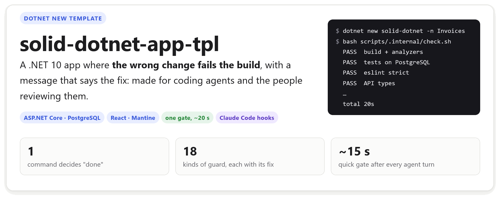

<!-- template:start -->
<picture>
  <source media="(prefers-color-scheme: dark)" srcset="docs/visual/board/img/readme/hero-dark.png">
  
</picture>

<picture>
  <source media="(prefers-color-scheme: dark)" srcset="docs/visual/board/img/readme/why-dark.png">
  
</picture>

## Create a project

```sh
git clone https://github.com/Manomenu/solid-dotnet-app-tpl.git
dotnet new install ./solid-dotnet-app-tpl
dotnet new solid-dotnet -n Invoices --port-offset 2 --allow-scripts yes
cd Invoices && just check
```

- `-n Invoices` renames `Myapp`/`myapp` everywhere: projects, namespaces, folders, docker names, databases.
  Use a simple name (letters and digits): it becomes a database, a container and a package name.
- `--port-offset N` (0-9) shifts every port by `10 * N`, so projects run side by side. Base ports: server 6300,
  web 3300, PostgreSQL 5533, compose web 8190, e2e 6301/3301.
- `--allow-scripts yes` lets the post action run `scripts/.internal/init-project.sh`: it regenerates the
  lockfiles, the API contract (`openapi.json`) and the web types from it, creates `docs/visual/spec/` for the
  living specs and the git repository on `master` with the hooks enabled, and removes the template notes
  (this block included). Without it, run `just init` yourself (it calls `init-project.proj`). The
  post action goes through MSBuild so that on Windows `bash` is Git's, not WSL's; install Git for Windows.
  It runs once, in the new project only (it refuses to run where `.template.config/` exists), and deletes itself.
  `dotnet new` writes every file without its executable bit, so it also marks the scripts and the pre-commit hook
  executable in the index (`git add --chmod=+x`), where Windows keeps the mode too.
- The template uses no templating directives inside files (no `#if` or `//#if`): it renames through `sourceName` and
  shifts ports through the symbols of `.template.config/template.json`, so the generated project has no comment to strip.
  A file that needs a directive later puts it on the allowed list of AGENTS.md, "No comments", and into its guard.
- `dotnet new uninstall <path>` removes the template. To share it as a file instead of a folder:
  `just pack-template`, then `dotnet new install .artifacts/nupkg/Solid.DotnetApp.Template.1.0.0.nupkg`.

<picture>
  <source media="(prefers-color-scheme: dark)" srcset="docs/visual/board/img/readme/flow-dark.png">
  
</picture>

<picture>
  <source media="(prefers-color-scheme: dark)" srcset="docs/visual/board/img/readme/features-dark.png">
  
</picture>

The full list, each guard with its fix: [docs/architecture.md, "What the gate forbids"](docs/architecture.md#what-the-gate-forbids).

<picture>
  <source media="(prefers-color-scheme: dark)" srcset="docs/visual/board/img/readme/choose-dark.png">
  
</picture>

<picture>
  <source media="(prefers-color-scheme: dark)" srcset="docs/visual/board/img/readme/architecture-dark.png">
  
</picture>

The pictures are drawn on `docs/visual/board/readme.html` and rendered with the suwagent plugin's
`vdoc.py render docs/visual/board/readme.html --picture`; edit the board, render again, commit both.
They are not copied into generated projects. Everything below this block is the README a generated project starts with.
<!-- template:end -->

# Myapp

An ASP.NET Core minimal-API server (Dapper, hand-written SQL, grate migrations) on [suwbackkit](https://github.com/Manomenu/suwbackkit), a React 19 + Tailwind web app styled by
[suwfrontkit](https://github.com/Manomenu/suwfrontkit) with types generated from the server's OpenAPI document, and a Notes feature
as the pattern end to end.

## What the gate guarantees

The gate is [suwgate](https://github.com/Manomenu/suwgate), configured in `suwgate.yml`: `just check` (`suwgate check`) before
calling a change done, the same CI runs; `just check-quick` while working, within a 20-second budget: the repository guards, and
build, csharpier, the .NET guards, eslint, tsc and shellcheck only for what changed since the branch left `master`. It fails on: any compiler or
analyzer warning, banned APIs, a layer used against its order, a folder or project off the lists the guards read, dead types and
packages, vague names, any comment but a tool directive, `dynamic`, browser storage, unpinned images, a stale API contract or
generated types, an acceptance criterion without a guardrail, an unresolvable compose file. The full list, each with its fix:
[docs/architecture.md, "What the gate forbids"](docs/architecture.md#what-the-gate-forbids).
The full gate also runs the browser tests, against their own server, ports and empty database; `just tmux-dev start` is the one way to run the stack.

## The API contract

`contract/openapi.json` is generated from the endpoints and committed: the contract on the boundary, with its version
in `contract/package.json`. `just api-types` regenerates it with the web types (`openapi.d.ts`, whose first line names
the contract's sha256), and the full gate (its `api-version` step, oasdiff) compares it with `master`: a changed contract needs a
higher version, a change that breaks a consumer a higher major. An app in another repository that adapts to a new version of this
contract tags its tests with `contract <name>@<version>` instead of a criterion id; the `contract-pins` step lists them.

## Spec ↔ guardrails sync

Development is spec-driven, and the gate keeps the code and the specs from drifting apart. A spec in
`docs/visual/spec/` (written with the suwagent `/suwagent:visual-spec` skill) says what to build and
why; its acceptance criteria are the contract:

1. **Every criterion has an id**, `AC-<feature>-<n>`, at the start of its item in the spec's
   acceptance section. `vdoc.py ids` of the suwagent plugin assigns them and never reuses a number;
   an id stays with its criterion for good.
2. **Outside the spec, a criterion lives only as a guardrail** that names its id: a test, a lint rule,
   a build rule. Not as a checklist or a QA note. A criterion that no automated check can prove is
   reworded into plain description or dropped from the spec (the agent asks the owner which).
3. **A spec written ahead of its feature is a draft** in `docs/draft/spec/`: the gate reads only `docs/visual/spec/`,
   where every criterion without a guardrail fails it. The draft moves there when its feature is built, together
   with its tests.
4. **The full gate checks the link both ways** (`suwgate check`, not `--quick`, so an agent can stop and ask
   about a criterion mid-work):

| The gate fails when | What to do |
| --- | --- |
| a criterion has no guardrail | name its id in a test or rule that fails when the criterion breaks |
| a guardrail names an id no spec defines | restore the criterion, or delete or rename the id |
| an id stands where nothing is checked (production code, a config no tool reads) | move it to the guardrail that proves the criterion |
| a spec has no acceptance section, a criterion without an id or with two, an id defined twice | fix the spec (`vdoc.py ids` numbers new criteria) |

Where each kind of guardrail lives and how it names the id comes with the profiles of `suwgate.yml` (the table is in
suwgate's README): `[Trait("criterion", "AC-notes-1")]` on an xUnit test, the id at the start of a Vitest or Playwright title
(`it("AC-notes-1: a blank note is refused", …)`), `// AC-notes-1` above a rule of `eslint.config.js` or an option of a tsconfig,
`# AC-notes-1` above a rule of `.editorconfig`, the id in the message of a banned-API line of the app's own, `<!-- AC-notes-1 -->` above a
property of `Directory.Build.props`. A kind of its own goes into a criteria.json at the root, with its row in a table here.

**How it runs.** The `criteria` step runs `vdoc.py criteria` of the
[suwagent plugin](https://github.com/Manomenu/suwalski-agent-plugin), downloaded at the commit and SHA-256 suwgate pins (into
`~/.cache/suwagent/`), the same on a laptop and in CI; without a network the step is a SKIP locally and a failure in CI. Agents
cannot edit the gate, the hooks or the lint configs (a Claude Code hook refuses it); to change them with an agent, start it with
`ALLOW_GATE_EDIT=1 claude`.

What it cannot see: whether a guardrail would really fail when the behaviour breaks.
`/suwagent:visual-guardrails` checks that before a merge.

## Requirements and commands

See [docs/development.md](docs/development.md). Rules for contributors and agents: [AGENTS.md](AGENTS.md).
