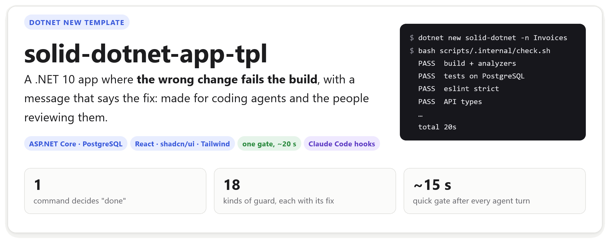
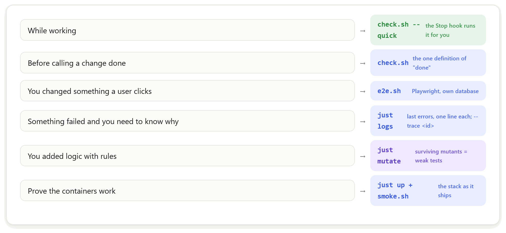

<!-- template:start -->
<picture>
  <source media="(prefers-color-scheme: dark)" srcset="docs/visual/board/img/readme/hero-dark.png">
  
</picture>

<picture>
  <source media="(prefers-color-scheme: dark)" srcset="docs/visual/board/img/readme/why-dark.png">
  
</picture>

## Create a project

```sh
git clone https://github.com/Manomenu/solid-dotnet-app-tpl.git
dotnet new install ./solid-dotnet-app-tpl
dotnet new solid-dotnet -n Invoices --port-offset 2 --allow-scripts yes
cd Invoices && bash scripts/.internal/check.sh
```

- `-n Invoices` renames `Myapp`/`myapp` everywhere: projects, namespaces, folders, docker names, databases.
  Use a simple name (letters and digits): it becomes a database, a container and a package name.
- `--port-offset N` (0-9) shifts every port by `10 * N`, so projects run side by side. Base ports: server 6300,
  web 3300, PostgreSQL 5533, compose web 8190, e2e 6301/3301.
- `--allow-scripts yes` lets the post action run `scripts/.internal/init-project.sh`: it regenerates the
  lockfiles, creates the git repository on `master` with the hooks enabled, and removes the template notes
  (this block included). Without it, run `dotnet msbuild scripts/.internal/init-project.proj` yourself. The
  post action goes through MSBuild so that on Windows `bash` is Git's, not WSL's; install Git for Windows.
- `dotnet new uninstall <path>` removes the template. To share it as a file instead of a folder:
  `just pack-template`, then `dotnet new install .artifacts/nupkg/Solid.DotnetApp.Template.1.0.0.nupkg`.

<picture>
  <source media="(prefers-color-scheme: dark)" srcset="docs/visual/board/img/readme/flow-dark.png">
  
</picture>

<picture>
  <source media="(prefers-color-scheme: dark)" srcset="docs/visual/board/img/readme/features-dark.png">
  
</picture>

The full list, each guard with its fix: [docs/architecture.md, "What the gate forbids"](docs/architecture.md#what-the-gate-forbids).

<picture>
  <source media="(prefers-color-scheme: dark)" srcset="docs/visual/board/img/readme/choose-dark.png">
  
</picture>

<picture>
  <source media="(prefers-color-scheme: dark)" srcset="docs/visual/board/img/readme/architecture-dark.png">
  
</picture>

The pictures are drawn on `docs/visual/board/readme.html` and rendered with the suwagent plugin's
`vdoc.py render docs/visual/board/readme.html --picture`; edit the board, render again, commit both.
They are not copied into generated projects. Everything below this block is the README a generated project starts with.
<!-- template:end -->

# Myapp

An ASP.NET Core minimal-API server (Npgsql, Dapper, hand-written SQL, grate migrations), a React 19 + shadcn/ui + Tailwind
web app with types generated from the server's OpenAPI document, and a Notes feature as the pattern end to end.

## What the gate guarantees

`bash scripts/.internal/check.sh` (`--quick` while working) fails on: any compiler or analyzer warning, banned
APIs, a layer used against its order, dead types and packages, vague names, stray comments, `dynamic`, unpinned
images, stale generated types, an unresolvable compose file. The full list, each with its fix:
[docs/architecture.md, "What the gate forbids"](docs/architecture.md#what-the-gate-forbids).
Browser tests run separately (`scripts/.internal/e2e.sh`), and `just up` starts the container stack and
smoke-tests it.

## Requirements and commands

See [docs/development.md](docs/development.md). Rules for contributors and agents: [AGENTS.md](AGENTS.md).
